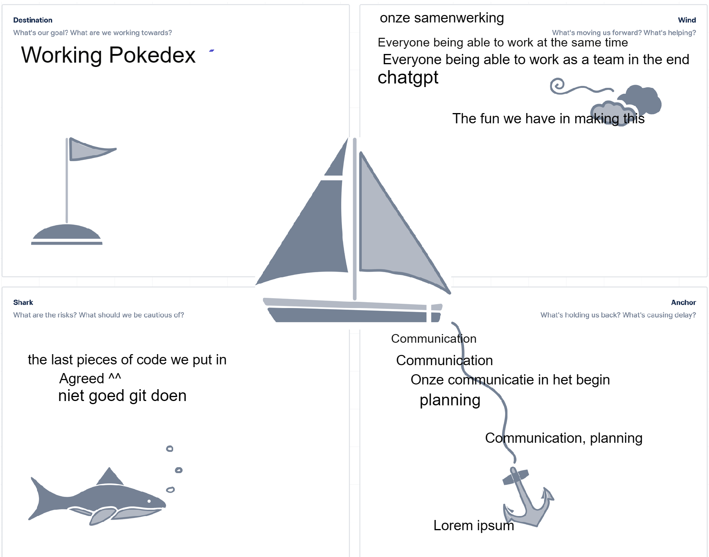

# Pokedex

-----------> https://rindogaming.github.io/Pokedex/Backend/Public/index.html <-----------

Front-end Planning

| Taak                                      | Prioriteit | tijdsinschatting | Status  |
| ----------------------------------------- | ---------- | ---------------- | ------- |
| Filter so you specify generation or type. | High       | 2 hrs            | ✔️ Done |
| First 3 generations a pokedex.            | Medium     | 4 hrs            | ✔️ Done |
| Pixel art for the old versions.           | Low        | 2 hrs            | ✔️ Done |
| User friendly info page.                  | Medium     | 2 hrs            |  🚧 Scrapped |
| Pokemon type chart.                       | Medium     | 8 hrs            | ✔️ done |
| showing the stats of all the different pokemon | Medium     | 8 hrs       | ✔️ done |
e

| Task                              | Priority | Time Estimate | What I Can Do (X)                                                                  | Need                                                           | Why                                                                           |
| --------------------------------- | -------- | ------------- | ---------------------------------------------------------------------------------- | -------------------------------------------------------------- | ----------------------------------------------------------------------------- |
| Filter so you specify generation or type. | High     | 2 hrs         | Sort the list by types (Example grass/poison) | Dropdown menu to filter between either 1 or 2 types. | It will be very difficult to browse the page without it. |
| First 3 generations a pokedex. | Medium     | 4 hrs         | Display the first 386 pokemon (including special forms?) on the page. | Using the API to get the data and then displaying it onto the page. | So there is something on the page. |
| Pixel art for the old versions. | Low     | 2 hrs         | Display the older sprites of that specific pokemon if they are availible. | Get the old sprites out of the API and display them on a section of the page. | See how the old sprites looked in older games compared to the new ones. |
| An info page to make it user friendly just so the user knows where it can do what. | High     | 2 hrs         | Give info for stuff like what you can see. | Info page | To get a bit of an idea of the website. |
| An easy to use place where you can type pokemon typing and then it wil show you what types are super effective or weak against. | Medium   | 8 hrs         | Type in a type (example grass) and see what types do super effective damage, not very effective damage or have no effect. | Seperate tab for that info (and maybe also on a pokemon his page). | To see type effectiveness. |

| Persoon/Tijd | Di 9:00-11:00 | Di 11:00-13:00 | Di 13:00-15:00 | Di 15:00-17:00 | Wo 9:00-11:00 | Wo 11:00-13:00 | Wo 13:00-14:00 | Wo 15:00-17:00 | Do 9:00-11:00 | Do 11:00-13:00 | Do 13:00-15:00 | Do 15:00-17:00 |
| --- | --- | --- | --- | --- | --- | --- | --- | --- | --- | --- | --- | --- |
| Hendrik | User friendly info page.  🚧  | User friendly info page.  🚧  | planning| styling| styling | styling | styling | styling | planning | styling | styling | styling |
| Jarno | read me and priority making ✔️ | styling| styling| styling| styling | styling | styling | styling | planning | showing the stats of all the different pokemon| showing the stats of all the different pokemon | showing the stats of all the different pokemon |
| Senn | styling | styling | styling | styling | egg animations | egg animations | egg animations | styling | styling | styling | styling | styling |

Back-end Planning

| Taak                              | Prioriteit | tijdsinschatting | Status  |
| --------------------------------- | ---------- | ---------------- | ------- |
| Pokémon Species Documentation     | High       | 8 hrs            | ✔️ Done |
| Pokémon Characteristics Database  | High       | 6 hrs            | ✔️ Done |
| PokéAPI → Firebase Connection     | High       | 8 hrs            | ✔️ Done|
| Database Structure Definition     | High       | 4 hrs            | ✔️ Done |
| Evolution Chain Analysis          | Medium     | 6 hrs            | ✔️ Done|
| Encounters and sprites Tracking   | Medium     | 6 hrs            | ✔️ Done|
| Primary/Secondary Type Filtering  | High       | 5 hrs            | ✔️ Done|
| Caching System for Local Data     | High       | 6 hrs            | ✔️ Done|
| Egg Hatching Gambling System      | Medium     | 8 hrs            | ✔️ Done|
| Pokémon Detail Page               | High       | 7 hrs            | ✔️ Done|
| Improve Frontend Caching          | High       | 6 hrs            | ✔️ Done|
| Extended Pokémon Details          | High       | 8 hrs            | ✔️ Done|
| Support All Pokémon Forms         | High       | 10 hrs           | ✔️ Done|

| Task                                                 | Priority | Time Estimate | What I Can Do (X)                                                                                 | Need                                                           | Why                                                                                                        |
| ---------------------------------------------------- | -------- | ------------- | ------------------------------------------------------------------------------------------------- | -------------------------------------------------------------- | ---------------------------------------------------------------------------------------------------------- |
| **Pokémon Species Documentation**                        | High     | 8 hrs         | Fetch data from PokéAPI and store it in Firebase with consistent IDs                              | Complete dataset of all gen 1 - gen 3 Pokémon species          | The frontend can directly load species info without making separate API calls                              |
| **Pokémon Characteristics Database**                     | High     | 6 hrs         | Create schema for abilities, growth rates, and natures, then link them to species                 | Detailed characteristics per Pokémon                           | Needed for research features and analysis                                                                  |
| **PokéAPI → Firebase Connection**                        | High     | 8 hrs         | Build a sync function that pushes data from PokéAPI into Firebase                                 | Reliable connection between external API and internal database | Without this connection, no base data is available                                                         |
| **Database Structure Definition**                        | High     | 4 hrs         | Design Firestore collections and document the schema                                              | Standardized data structure                                    | The frontend can query efficiently and display data correctly                                              |                                                 |
| **Evolution Chain Analysis**                             | Medium   | 6 hrs         | Parse evolution data from PokéAPI and store it as nested structures in Firebase                   | Insight into Pokémon evolution patterns                        | Needed to visualize Pokémon development and relationships                                                  |
| **Generation and Version Tracking**                      | Medium   | 6 hrs         | Tag Pokémon data with generation and version information                                          | Historical and game-context data                               | Useful for comparing across gens and filtering content                                                     |
| **Primary/Secondary Type Filtering**                 | High     | 5 hrs         | Add dropdown filters for primary and secondary Pokémon types                                      | Users can filter Pokémon by typing combinations                | Helps players quickly find Pokémon like *Fire/Fighting* combinations                                       |
| **Caching System for Local Data**                    | High     | 6 hrs         | Save fetched API data into JSON and serve cached results                                          | Faster load times and resilience against API/Firebase downtime | Improves user experience, especially when servers are slow or offline                                      |
| **Egg Hatching Gambling System**                     | Medium   | 8 hrs         | Randomly assign Pokémon from the dataset and track duplicates                                     | Fun, replayable game feature                                   | Adds engagement and progression system for users                                                           |
| **Pokémon Detail Page**                              | High     | 7 hrs         | Create dedicated detail views for each Pokémon with structured data                               | More in-depth Pokémon information                              | Provides depth and value to each Pokémon beyond list view                                                  |
| **Improve Frontend Caching**                         | High     | 6 hrs         | Optimize cache delivery for end-users (e.g. prefetching, CDN, versioned cache)                    | Faster frontend performance for remote users                   | Solves the current issue of frontend being slower for users than devs                                      |
| **Extended Pokémon Details**                         | High     | 8 hrs         | Fetch and store more fields (excluding moves) for the detail page                                 | Richer Pokémon profiles                                        | Improves depth without overwhelming performance                                                            |
| **Support All Pokémon Forms**                        | High     | 10 hrs        | Include alternate forms (mega, regional, gender, etc.) in dataset                                 | Complete dataset up to 1164 entries                            | Ensures database is comprehensive and up to date                                                           |

| Persoon/Tijd | Di 9:00-11:00 | Di 11:00-13:00 | Di 13:00-15:00 | Di 15:00-17:00 | Wo 9:00-11:00 | Wo 11:00-13:00 | Wo 13:00-14:00 | Wo 15:00-17:00 | Do 9:00-11:00 | Do 11:00-13:00 | Do 13:00-15:00 | Do 15:00-17:00 |
| --- | --- | --- | --- | --- | --- | --- | --- | --- | --- | --- | --- | --- |
| Alex | Pokémon Characteristics Database (6u, High) ✔️ | Pokémon Characteristics Database (6u, High) ✔️ | All pokemon form support ✔️| All pokemon form support ✔️| Pokemon charactaristic database (high, 6h) ✔️ | Pokemon charactaristic database ✔️ (6u, high) | Encounters and sprites ✔️| Battle (4u, Medium) ✔️| Battle (4u, Medium) ✔️| Select your pokemon (8u, Medium) ✔️| Select your pokemon (8u, Medium) ✔️| Filters for selecting (8u, Medium) ✔️|
| Jay | Planning, read me and priority making ✔️ | Database Structure Definition(4u, High) ✔️| Cache fix ✔️| Cache fix ✔️| Pokemon species documentation (8u, High) ✔️| Pokemon species documentation (8u, High) ✔️ | Pokemon species documentation (8u, High) ✔️| Pokemon species documentation (8u, High) ✔️| Database structure definition (2u, Low) ✔️| Data logging and monitoring (2u, Low) 🚧| encounters and sprites (2u, Low) ✔️ |  |
| Caspar | PokéAPI → Firebase Connection(8u, High) ✔️ | Pokémon Characteristics Database (6u, High) ✔️ | Evolution chain analysis (4u, High) ✔️|  Evolution chain analysis (4u, High) ✔️ | Pokemon species documentation (8u, High) ✔️ | Pokemon species documentation (8u, High) ✔️| Pokemon species documentation (8u, High) ✔️| Pokemon species documentation (8u, High) ✔️| Database structure definition (2u, Low)🟡 | encounters and sprites (2u, Low) ✔️ | egg hatching more (2u, Low) ✔️|  |

In progress → 🟡
Scrapped -> 🚧
Done → ✔

---------------------------------------------------------------------------------
# Retrospective

# Mee nemen naar het volgende project

Alex 
-
- Een persoon neemt de leiding.
- Tijd beter inschatten.

Caspar
-
- Samen werking
- Hendrik en Jarno de planning laten maken 😎

Hendrik
-
- Goed samen werken.
- De manier waarop wij samen werkte.

Jarno
-
- Zorgen dat er betere communicatie is.
- Planning wat beter organiseren.

Jay
-
- Refactoring code at the end of the day/ hour of the day.
- Better time management in both planning and execution.

Senn
-
-  De planning wordt door 1 persoon gedaan.
-  Meer chatgpt gebruiken.

